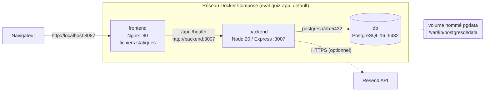

# J1 — Conteneurisation locale

## 1. Analyse préalable de l'application

| Composant  | Rôle | Port | Exposé sur l'hôte ? |
|---|---|---|---|
| frontend (Nginx) | Sert les fichiers HTML/JS/CSS compilés par Vite et fait **reverse proxy** de `/api` et `/health` vers le backend | 80 (conteneur) | **Oui** → `8087` |
| backend (Node/Express) | API : inscription, résultats, admin JWT, envoi mail Resend | 3007 | Non (réseau interne) |
| db (PostgreSQL 16) | Stocke `users`, `quiz_results`, `answers` | 5432 | Non (réseau interne) |

- **Questionnaires** : codés en dur dans les fichiers `questions_*.js` à la racine (embarqués dans le build Vite).
- **Résultats** : envoyés par `POST /api/results` puis stockés dans PostgreSQL.
- **Le frontend appelle l'API en relatif** (`/api` dans `main.js` et `public/admin.js`) → il faut un reverse proxy sur la même origine : c'est le rôle de Nginx (`nginx/nginx.conf`, upstream `backend:3007`).
- **Routes de test** : `GET /health` (ne touche pas la base), `POST /api/users` (écrit en base).

### Variables : publiques vs secrets

| Variable | Type |
|---|---|
| `POSTGRES_USER`, `POSTGRES_DB`, `FROM_EMAIL`, `ADMIN_USERNAME` | Configuration |
| `POSTGRES_PASSWORD`, `DATABASE_URL` (contient le mot de passe), `RESEND_API_KEY`, `ADMIN_PASSWORD`, `JWT_SECRET` | **Secrets** |

### Constats importants (vérifiés par test)

1. **Sans `RESEND_API_KEY`, le backend crashe au démarrage** : `new Resend(undefined)` lève `Missing API key`. Une valeur factice (`re_xxxx`) suffit pour démarrer ; seul l'envoi de mail échouera (erreur loguée, pas de crash).
2. **Le backend démarre sans base** : `pg.Pool` ne se connecte qu'à la première requête. `/health` répond donc 200 même sans PostgreSQL (utile pour J4).
3. **Nginx refuse de démarrer si l'upstream `backend` n'est pas résolvable** → le conteneur frontend seul (`docker run`) plante ; il fonctionne dans Compose où le nom `backend` existe.
4. `init.sql` n'est **pas idempotent** (`CREATE TABLE` sans `IF NOT EXISTS`) : il ne doit être exécuté qu'une fois.

## 2. Schéma d'architecture locale



## 3. Choix des Dockerfiles

### `backend/Dockerfile`
- **`node:20-alpine`** : Node 20 exigé par la doc ; Alpine = image légère, moins de paquets donc moins de CVE.
- **`package-lock.json` ajouté** (généré avec `npm install --package-lock-only`, aucune modif métier) → `npm ci` installe des versions **figées** = build reproductible.
- **Ordre des couches** : `COPY package*.json` puis `npm ci` *avant* `COPY server.js` → la couche des dépendances reste en cache tant que les dépendances ne changent pas.
- **`--omit=dev`** + `npm cache clean` : pas de dépendances de dev ni de cache dans l'image.
- **`USER node`** : le processus ne tourne pas en root (utilisateur fourni par l'image officielle).
- Seul `server.js` est copié (pas de `.env`, pas de `node_modules` local grâce au `.dockerignore`).

### `Dockerfile` (frontend, racine) — build **multi-stage**
- **Étape `build`** (`node:20-alpine`) : `npm ci` + `npm run build` → produit `dist/`.
- **Étape finale** (`nginx:alpine`) : uniquement Nginx + `dist/` + `nginx.conf`. Node, Vite et `node_modules` **ne sont pas dans l'image finale** → ~100 Mo au lieu de plusieurs centaines, surface d'attaque réduite.
- `.dockerignore` racine : exclut `backend/`, `docs/`, `.git`, `.env`, `node_modules` → contexte de build plus petit et aucun secret copié.

## 4. `docker-compose.yml`

- **Un seul port publié** : `8087:80` sur le frontend. Backend et base restent joignables seulement par le réseau interne (résolution DNS par nom de service : `backend`, `db`).
- **Volume nommé `pgdata`** monté sur `/var/lib/postgresql/data` → les données survivent à `docker compose down` et à la recréation des conteneurs. Seul `docker compose down -v` supprime le volume.
- **`init.sql` monté dans `/docker-entrypoint-initdb.d/`** : l'image officielle PostgreSQL l'exécute **uniquement si le volume est vide** (premier démarrage). Pas de réexécution → pas de conflit avec le `CREATE TABLE` non idempotent.
- **`healthcheck` `pg_isready` + `depends_on: condition: service_healthy`** : le backend ne démarre qu'une fois PostgreSQL prêt à accepter des connexions.
- **Variables** lues depuis `.env` (non versionné, déjà dans `.gitignore`) ; `DATABASE_URL` est construite à partir des variables `POSTGRES_*`.
- `restart: unless-stopped` : redémarrage automatique en cas de crash.

## 5. Procédure de lancement

```bash
cp .env.example .env        # puis changer les mots de passe et JWT_SECRET
docker compose up -d --build
docker compose ps           # 3 services Up, db (healthy)
curl http://localhost:8087/health      # {"status":"ok"}
```
- Quiz : http://localhost:8087
- Admin : http://localhost:8087/gestion-quiz (identifiants `ADMIN_*` du `.env`)

## 6. Test de persistance

```bash
# 1. créer un utilisateur (via l'interface ou :)
curl -X POST http://localhost:8087/api/users -H 'Content-Type: application/json' \
     -d '{"firstname":"Persist","email":"persist@test.fr"}'
# 2. supprimer les conteneurs SANS supprimer le volume
docker compose down
docker volume ls | grep pgdata          # le volume est toujours là
# 3. recréer et vérifier
docker compose up -d
docker compose exec db psql -U quiz_user -d quiz_db -c "SELECT id, firstname, email FROM users;"
```
Sortie complète : [`preuves/J1/sortie-tests-persistance.txt`](../preuves/J1/sortie-tests-persistance.txt).

## 7. Questions probables à l'oral

- *Pourquoi Nginx ?* → le front appelle `/api` en relatif, il faut un proxy sur la même origine ; et servir des fichiers statiques sans Node en prod.
- *Différence volume nommé / bind mount ?* → volume géré par Docker (portable, pas de problème de droits) ; bind mount = dossier de l'hôte (utilisé ici en lecture seule pour `init.sql`).
- *Que se passe-t-il avec `down -v` ?* → volume supprimé, base vide, `init.sql` rejoué au prochain `up`.
- *Pourquoi `depends_on` seul ne suffit pas ?* → il attend que le conteneur *démarre*, pas que Postgres soit *prêt* ; d'où le healthcheck.
- *Pourquoi le backend plante sans clé Resend ?* → le SDK Resend v2 lève une exception dans son constructeur, exécuté au chargement du module.
