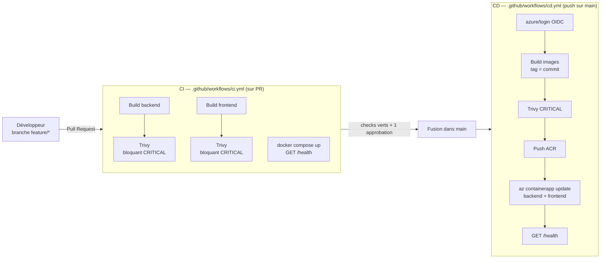

# J6 — Pipeline CI/CD (GitHub Actions)

## Vue d'ensemble



## CI (`ci.yml`) — sur chaque Pull Request vers `main`

| Job | Rôle |
|---|---|
| `Build + Trivy (backend)` / `(frontend)` | `docker build --pull`, rapport Trivy HIGH+CRITICAL archivé en artefact, puis **contrôle bloquant** `--severity CRITICAL --exit-code 1` |
| `Test de démarrage (Docker Compose)` | Démarre la stack avec `.env.example` et attend `GET /health` = 200 |

Aucun accès Azure : la CI ne déploie rien et n'a besoin d'aucun secret.

## CD (`cd.yml`) — après fusion sur `main`

1. `azure/login` en **OIDC** ;
2. build des images, tag = **hash court du commit** (+ `latest`) ;
3. nouveau contrôle Trivy CRITICAL (au cas où une CVE serait publiée entre la PR et la fusion) ;
4. `docker push` vers l'ACR ;
5. `az containerapp update --image ...:<commit>` pour le backend puis le frontend (nouvelle révision) ;
6. vérification `GET https://<frontend>/health`.

`concurrency: deploy-production` empêche deux déploiements simultanés. Les noms (RG, ACR, apps) sont lus dans `scripts/config.sh` : une seule source de vérité pour les scripts et le pipeline.

## Authentification GitHub → Azure sans secret (OIDC)

Script : `./scripts/setup-github-oidc.sh` (à lancer une fois avec `az login`).

- Identité managée **`id-quiz-github`** avec un **identifiant fédéré** : elle n'accepte que les jetons OIDC émis par GitHub pour `repo:Loupox78@150783612/eval-quiz-app@1472881647:ref:refs/heads/main` (nom + identifiants numériques immuables du compte et du dépôt). Une PR, une autre branche ou un autre dépôt ne peut pas déployer.
- Rôles minimaux : **AcrPush** sur l'ACR, **Contributor** limité au groupe `rg-quiz-app`.
- GitHub ne stocke que `AZURE_CLIENT_ID`, `AZURE_TENANT_ID`, `AZURE_SUBSCRIPTION_ID` : des identifiants, inutilisables sans jeton OIDC. Aucun mot de passe ni secret client longue durée.
- Une identité managée (plutôt qu'une « App registration » Entra ID) évite d'avoir besoin du droit de créer des applications dans l'annuaire de l'école.

## Secrets applicatifs

Les secrets de l'application (`database-url`, `jwt-secret`, …) restent dans les Container Apps (posés par `deploy.sh apps`). Le pipeline ne fait que changer l'image : il n'a jamais accès à ces valeurs.

## Protection de `main`

Settings → Branches → règle sur `main` :
- Pull Request obligatoire, **1 approbation** requise ;
- checks obligatoires : `Build + Trivy (backend)`, `Build + Trivy (frontend)`, `Test de démarrage (Docker Compose)` ;
- pas de push direct.

## Questions probables à l'oral

- *Que se passe-t-il si une PR introduit une CVE CRITICAL ?* → le job Trivy sort en code 1, le check est rouge, la protection de `main` empêche la fusion.
- *Comment GitHub s'authentifie sur Azure ?* → OIDC : GitHub signe un jeton décrivant le dépôt et la branche ; Azure le compare à l'identifiant fédéré et délivre un accès temporaire.
- *Pourquoi la CI n'a pas accès à Azure ?* → une PR peut venir de code non encore relu ; seul `main` (après revue) peut déployer.
- *Comment revenir en arrière ?* → `az containerapp update --image ...:<ancien_tag>` ou réactiver l'ancienne révision : chaque image est taguée par commit.

## Incident : premier déploiement refusé par Azure (OIDC)

Premier run du workflow CD après la fusion de la PR #9 :
```
AADSTS700213: No matching federated identity record found for presented assertion subject
'repo:Loupox78@150783612/eval-quiz-app@1472881647:ref:refs/heads/main'
```
**Diagnostic** : l'identifiant fédéré avait été créé avec le format historique `repo:Loupox78/eval-quiz-app:ref:refs/heads/main`. GitHub présente désormais un *subject* qui inclut les **identifiants numériques** du propriétaire (`150783612`) et du dépôt (`1472881647`). Azure compare la chaîne exactement : refus.
**Correction** : nouvel identifiant fédéré `github-main-ids` avec le subject exact (script `setup-github-oidc.sh` mis à jour), puis relance du workflow (*Re-run jobs*). Intérêt de ce format : si le dépôt était supprimé puis recréé sous le même nom par quelqu'un d'autre, ses identifiants numériques changeraient et il n'obtiendrait pas l'accès Azure.
