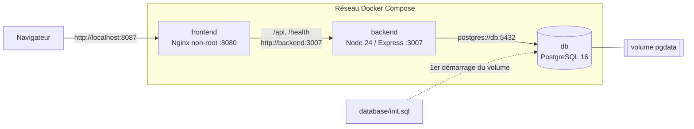
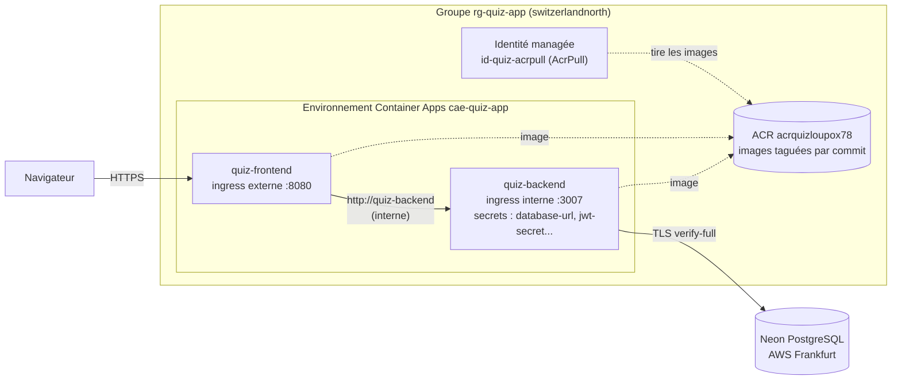
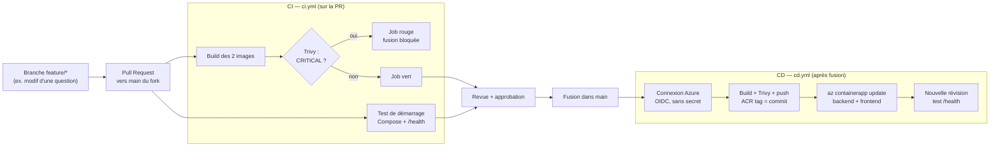

# Architecture de Quiz App (local, cloud et chaîne de livraison)

Schémas faits par le groupe (Mermaid, affichés directement par GitHub).

## 1. En local (Docker Compose)

- Un seul port ouvert sur la machine : **8087** (→ 8080 dans le conteneur frontend).
- `backend` et `db` ne sont joignables que dans le réseau Compose (par leur nom de service).
- Les données sont dans le **volume `pgdata`** : `docker compose down` puis `up` les garde, seul `down -v` les efface.

## 2. Sur Azure

- Seul le **frontend** a une URL publique. Le backend est en ingress interne.
- Les apps tirent leurs images de l'ACR avec une **identité managée** (rôle `AcrPull`), sans mot de passe de registre.
- La base n'est plus un conteneur : c'est **Neon** (PostgreSQL managé), connexion chiffrée. La chaîne de connexion est un **secret** Container Apps.

## 3. Chaîne de livraison (GitHub Actions)

- Une PR ne déploie **jamais** rien : elle n'a ni secret ni accès Azure.
- Le déploiement ne se lance qu'après fusion dans `main`.
- Le tag d'image = hash du commit → on sait exactement quel code tourne dans chaque révision.

## Tableau des ports

| Composant | Dans le conteneur | Exposé en local | Exposé sur Azure |
|---|---|---|---|
| frontend (Nginx) | 8080 | 8087 | HTTPS 443 (URL publique) |
| backend (Express) | 3007 | non | non (interne uniquement) |
| PostgreSQL | 5432 | non | — (Neon, hors Azure) |
